<div align="center">
  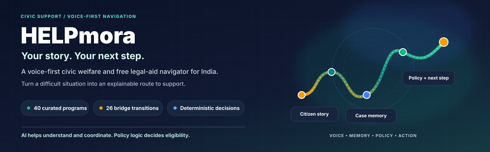

  **Voice-first civic welfare and free legal-aid navigation for India**

  [](https://www.python.org/)
  [](https://www.jac-lang.org/)
  [](https://qdrant.tech/)
  [](https://www.lyzr.ai/)
  [](https://omi.me/)
  [](./helpmora/tests)
  [](./LICENSE)

  [Architecture](#4-architecture) · [System Overview](#1-what-is-helpmora) · [Security & Privacy](#11-security-and-privacy) · [Local Setup](#14-local-development) · [Hackathon Demo](#17-demo-scenario)
</div>

---

## 1. What is HELPmora?

**HELPmora** is an open-source, voice-first Civic Welfare & Free Legal Aid Navigator for India. It is designed to help people describe a difficult situation in everyday language, discover relevant public-support pathways, understand the information needed for a decision, and identify a practical next step.

Public-service information is often spread across departments and portals, while eligibility rules and application procedures can be difficult to interpret. HELPmora aims to bridge that gap by converting a person's story into a structured case, evaluating configured program rules through deterministic code, searching curated graph transitions when a direct route is blocked, and presenting an actionable plan.

The project handbook describes a catalog of **40 curated Indian welfare programs**, **26 curated transition paths**, multilingual dictionaries, Qdrant-backed case memory, Lyzr-based orchestration, and a Jac/Python application protected by the `cmguard` gateway. These are repository/documentation inventory figures; current policy accuracy, language quality and live integration status must still be validated against the running build.

### The central principle

> **AI helps understand and coordinate. Deterministic HELPmora policy logic decides eligibility.**

An LLM should not invent legal rights, eligibility thresholds, schemes, official links or emergency contacts. Lyzr can coordinate suitable tasks and explain tool results; the existing Jac engine remains authoritative for policy scoring, Pathfinder traversal and deterministic crisis routing.

## 2. The problem HELPmora addresses

| Challenge | What HELPmora is designed to do |
|---|---|
| Fragmented program information | Search a curated catalog of welfare resources and their configured rules. |
| Bureaucratic language | Turn a natural-language story into structured facts and explain results in simpler language. |
| Missing documents or prerequisites | Use curated graph transitions to look for a bridge route where one exists. |
| Repeated case explanations | Retrieve relevant, user-scoped case memory when persistence is enabled and consented to. |
| Risky AI-made policy claims | Keep authoritative eligibility and crisis decisions in deterministic code. |
| High-friction forms | Guide the user through progressive steps, document lists and available submission channels. |

HELPmora's goal is to make the path clearer—not to guarantee approval or replace official agencies, qualified legal professionals or emergency services.

## 3. Scope and documented inventory

<div align="center">
  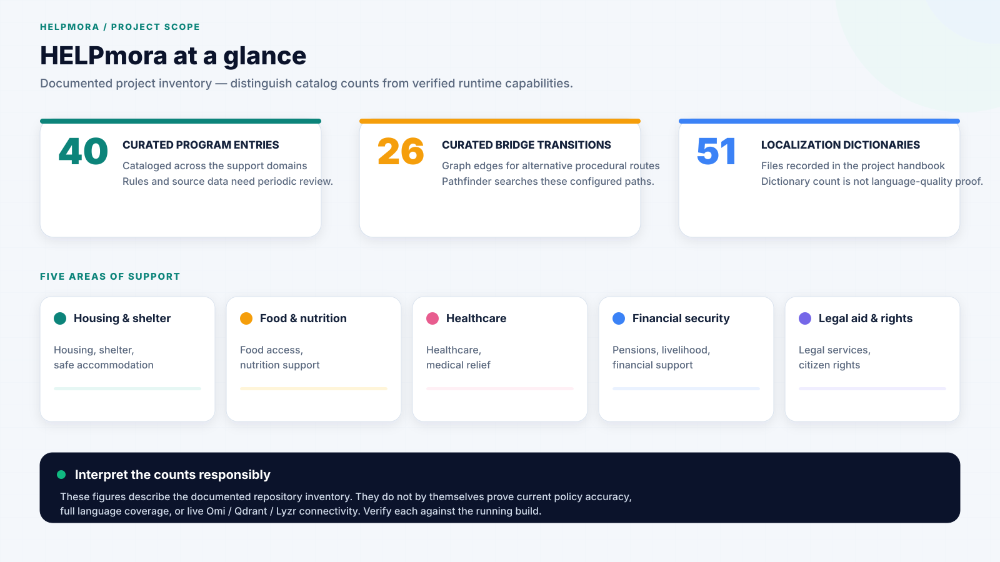
</div>

| Inventory | Documented scope | Important interpretation |
|---|---|---|
| Program catalog | 40 entries in `helpmora/data/resources.json` | The entries require periodic review against official sources, jurisdiction and effective date. |
| Bridge transitions | 26 entries in `helpmora/data/transitions.json` | Pathfinder can search configured edges; it cannot create a valid statutory path that is absent from the data. |
| Localization | 51 dictionaries are listed in `helpmora/data/i18n/` in the project handbook | A dictionary count does not prove that voice recognition, translation and output are complete or human-validated for every language. |
| Core domains | Housing/shelter, food/nutrition, healthcare/medical relief, financial security/livelihood, legal aid/citizen rights | Some programs may cover more than one area. Use the data catalog as the runtime source. |

### Representative catalog examples

| Domain | Examples named in the project handbook |
|---|---|
| Housing and shelter | PMAY-Urban, Shelter for Urban Homeless, Sakhi Niwas, Shakti Sadan, Affordable Rental Housing Complexes |
| Food and nutrition | NFSA Priority Household, Antyodaya Anna Yojana, PM-GKAY, Annapurna, subsidized community kitchens |
| Healthcare and medical relief | Ayushman Bharat PM-JAY, Rashtriya Arogya Nidhi, eSanjeevani, Jan Aushadhi |
| Financial security and livelihood | PM-KISAN, MGNREGA, PM SVANidhi, old-age/widow/disability pension programs |
| Legal aid and citizen rights | NALSA/DLSA free legal services, Tele-Law, NHRC redressal, e-Daakhil, One Stop Centres |

Do not use this README as the runtime policy source. Eligibility rules, amounts, program names, effective dates, required documents and URLs must be read from the maintained application data and checked against official sources before production use.

## 4. Architecture

### 4.1 System overview

<div align="center">
  
</div>

HELPmora is organized around distinct responsibilities:

1. **Input adapters** receive Omi transcript/conversation events and typed input. Browser-microphone voice is an optional interface when enabled; it is not itself an Omi integration.
2. **Perimeter and guardrails** validate requests, enforce route controls and apply domain/crisis handling. The documented `cmguard` layer provides route allowlisting, request-size/depth controls, rate limiting, token validation, budget control and redaction.
3. **Case and memory services** normalize input into case state and retrieve relevant user-scoped Qdrant memory when configured and permitted.
4. **Adaptive/perceptual model layer** (Omi, Lyzr and the existing byLLM/configured model chain where enabled) handles voice events, language/text extraction and task coordination.
5. **Deterministic Jac core** performs the authoritative policy scoring and graph traversal, plus navigation and crisis behavior.
6. **Guided delivery** presents the result, explains missing facts and next steps, asks for user review, and only carries out consequential actions after the required approval.

### 4.2 Request lifecycle

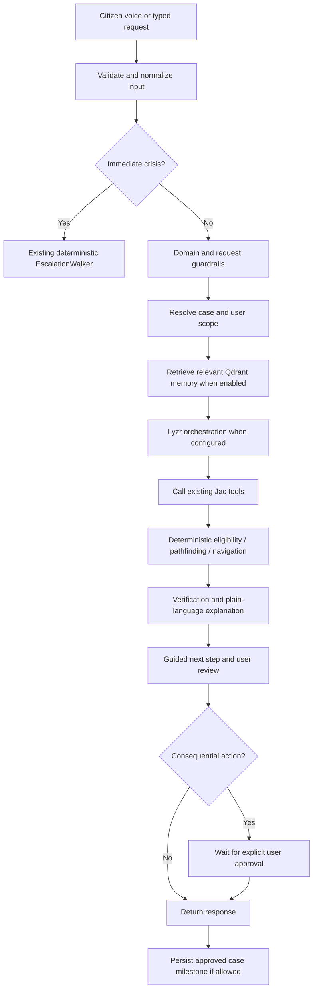

The request lifecycle should produce observable events. A state such as “Qdrant retrieved memory” or “Lyzr completed” must only be shown when the corresponding operation actually succeeded.

### 4.3 Voice-to-action sequence

<div align="center">
  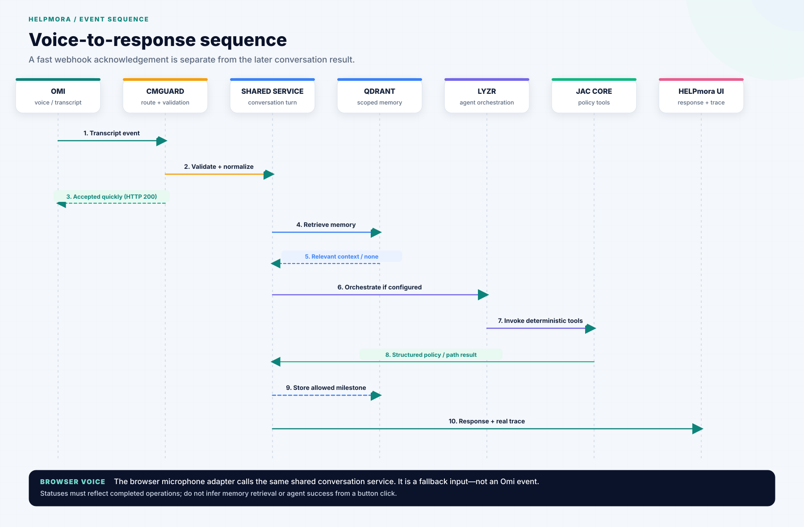
</div>

Omi webhooks should acknowledge accepted events promptly and process slow work separately. An HTTP success response means the event was accepted—not that every downstream model, memory and policy step has completed. Track later completion or failure in the execution trace.

### 4.4 Agent orchestration and policy boundary

<div align="center">
  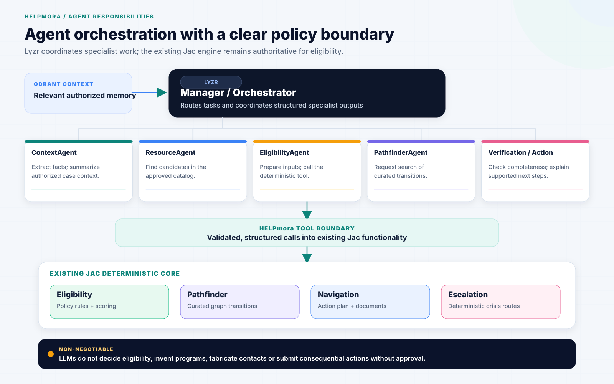
</div>

| Agent role (as described in the project design) | Responsibility | Must not do |
|---|---|---|
| ContextAgent | Interpret user request and summarize relevant, authorized case context. | Invent missing user facts. |
| ResourceAgent | Identify candidates from the approved resource catalog. | Invent schemes or unsupported benefits. |
| EligibilityAgent | Prepare structured inputs and request deterministic evaluation. | Make final eligibility decisions by LLM judgment. |
| PathfinderAgent | Request a search of existing transition paths when needed. | Fabricate graph edges or guarantee the path will succeed. |
| Verification / gate role | Check completeness, consistency and available provenance. | Claim a rule is verified without supporting data. |
| Action role | Explain the result and prepare guided next steps. | Submit consequential actions without the required consent. |

The exact configured agent set depends on the actual Lyzr setup. Document and display only agents that exist and execute in the running environment.

## 5. Jac graph model

<div align="center">
  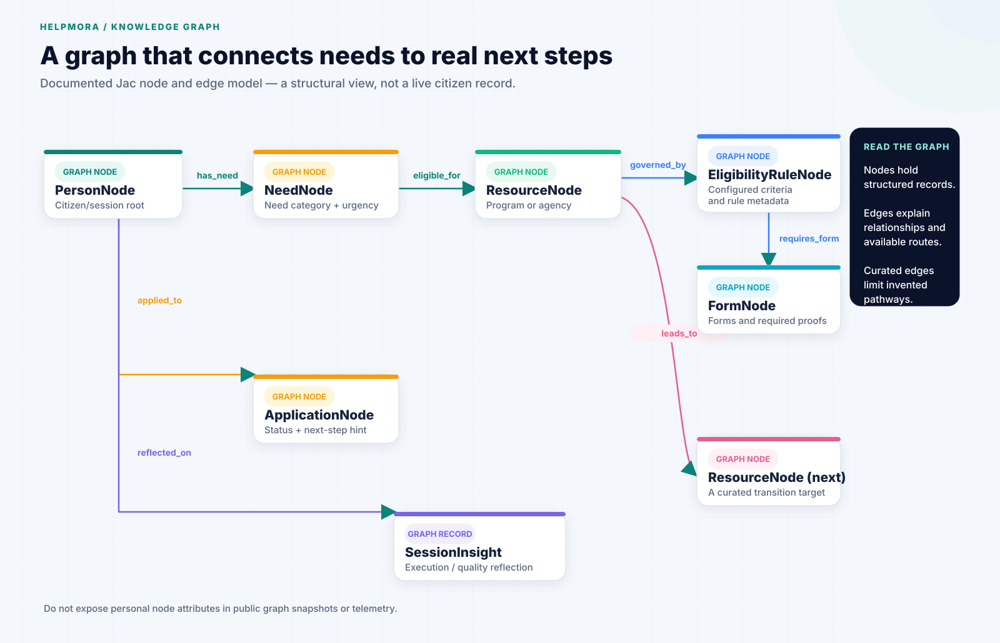
</div>

The project describes an in-memory or persisted directed Jac graph. Its documented nodes and edges include:

### Node types

| Node | Purpose | Example attributes named in the project handbook |
|---|---|---|
| `PersonNode` | Root for citizen/session context | `user_id`, language, location, income bracket, family size |
| `NeedNode` | Expressed civic problem | category, urgency, details |
| `ResourceNode` | Program or agency | agency, category, contact, address, online URL |
| `EligibilityRuleNode` | Configured rule data | income limit, residency requirements, criteria and audit values |
| `FormNode` | Required procedural form or proof | form name, URL, documents, submission method |
| `ApplicationNode` | Case/application tracking | status, denial reason, next-step hint |
| `SessionInsight` | Execution/quality reflection | walkers invoked, estimated calls, escalation/pathfinder flags, quality metrics |

### Edge types

| Edge | Meaning |
|---|---|
| `has_need` | Links a person to an expressed need. |
| `eligible_for` | Links a need to a resource and carries configured match information. |
| `governed_by` | Links a resource to its eligibility rule. |
| `requires_form` | Links a rule to required forms/proofs. |
| `applied_to` | Links a person/case to an application record. |
| `leads_to` | Represents a curated transition between resources or procedural steps. |
| `reflected_on` | Links a person/case to a session insight. |

The graph provides a structured way to relate needs, policy rules, programs, documents and next steps. Keep real-person identifiers and sensitive fields out of public graph snapshots and telemetry.

## 6. Jac walkers and responsibilities

<div align="center">
  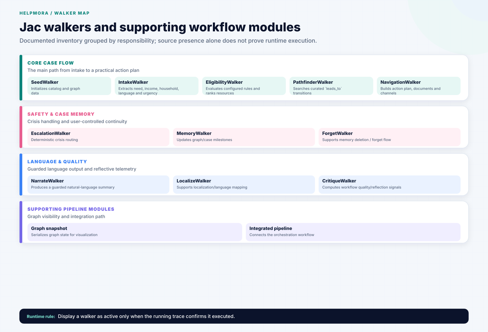
</div>

The project handbook describes these main workflow roles:

| Walker | Responsibility |
|---|---|
| `SeedWalker` | Idempotently initializes the graph/catalog data. |
| `IntakeWalker` | Extracts need category, income, household facts, language and urgency. |
| `EligibilityWalker` | Evaluates configured eligibility rules and ranks resources. |
| `PathfinderWalker` | Traverses curated `leads_to` edges using graph search to find alternative routes. |
| `NavigationWalker` | Builds an action plan, document checklist and available submission channels. |
| `EscalationWalker` | Applies deterministic crisis routing using the configured verified information. |
| `MemoryWalker` | Updates graph/case state and milestones. |
| `ForgetWalker` | Supports the documented right-to-be-forgotten flow. |
| `CritiqueWalker` | Computes workflow reflection/quality telemetry. |
| `NarrateWalker` | Produces a natural-language summary through the guarded model path. |
| `LocalizeWalker` | Supports localization/language mapping. |
| `graph_snapshot.jac` (graph snapshot) | Serializes graph state for visualization. |
| `integrated_pipeline.jac` (integrated pipeline) | Bridges the integrated orchestration path. |

The handbook groups the first roles into the principal workflow and also inventories supporting walkers. Whether a walker is registered, reachable and executed must be confirmed in the running application and its trace; a source file alone does not prove runtime execution.

## 7. Persistent memory with Qdrant

Qdrant is intended to retain semantically searchable case context across interactions. It should complement—not replace—the Jac graph or structured case state.

### Typical memory lifecycle

1. Normalize the current request into structured case facts.
2. Apply privacy minimization and the user's memory preference.
3. Embed an approved memory item using the configured embedding approach.
4. Store a vector plus payload metadata in the configured Qdrant collection.
5. Retrieve relevant records using semantic similarity and strict user/case filters.
6. Pass only appropriate, relevant context into orchestration.
7. Persist an appropriate milestone after the workflow step completes, if memory is enabled.
8. Support deletion when the user invokes the documented forget function.

### Recommended payload concepts

| Field | Why it matters |
|---|---|
| `user_id` / tenant key | Enforces retrieval and deletion boundaries. |
| `case_id` | Groups memory to a specific case. |
| `session_id` | Helps associate events with an interaction. |
| `memory_type` | Separates case state, milestone, confirmed fact or summary. |
| `text` / searchable summary | Provides semantic retrieval content. |
| timestamp / language / workflow step | Supports context and continuation. |
| consent/retention metadata where designed | Supports user-controlled persistence. |

The actual payload schema must follow the implementation in `helpmora/integrations/qdrant/schemas.py`. Do not introduce a conflicting schema based solely on this README.

### Local and cloud mode

The existing configuration documents `QDRANT_URL`, `QDRANT_API_KEY`, `QDRANT_COLLECTION_NAME` and `QDRANT_STORAGE_PATH`. Inspect the existing client to determine whether an empty URL selects embedded local storage, a local Qdrant server, or another fallback. Do not assume embedded mode works unless the installed client and current code implement it. Collections should be initialized idempotently; never delete production memory just to reinitialize a collection.

## 8. Omi and voice input

Omi is the required voice/ambient input integration for the hackathon. The application documentation inventories Omi webhook routes and an adapter that normalizes payloads and deduplicates events.

### Omi path

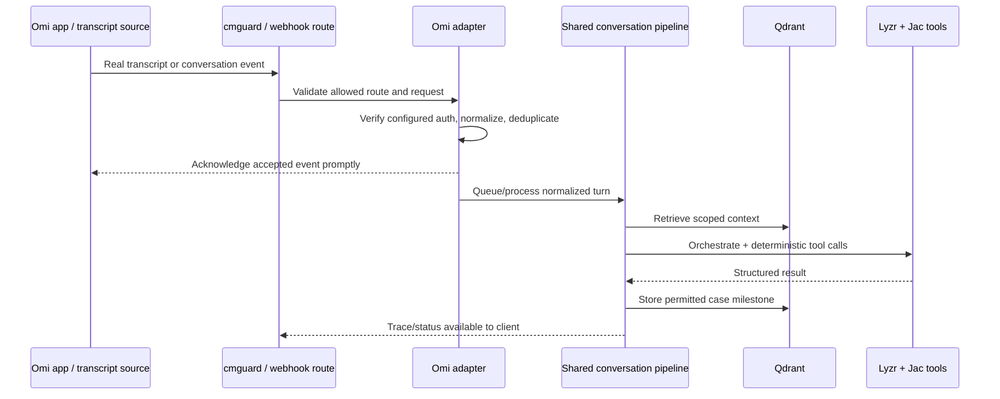

### Browser microphone path

Browser voice may be offered as an input alternative, subject to browser/API support and the current frontend implementation. It must use the same conversation service as Omi. **Browser microphone input alone is not a genuine Omi integration.** Browser speech recognition may be processed by a browser-managed or external service depending on the chosen implementation; disclose this accurately and do not claim fully local transcription unless verified.

### Response channels

The response can be shown in the HELPmora UI. Browser speech synthesis may be used for read-aloud when supported and enabled. Do not assume an incoming Omi webhook response automatically plays spoken audio in the Omi app. Omi-side outbound notifications or response delivery must use a documented, implemented and tested API capability.

## 9. Guided workflow and accessibility

The `AdaptiveAssistant` components are described as providing a six-step guided workflow, voice-to-form support, privacy toggles and a human-approval gate. Related features listed in the handbook include:

- High-contrast mode.
- Large-text mode.
- Reduced motion.
- Simple-language mode.
- Transcript and chat interaction.
- Progressive form and field explanation.
- Guided recovery when information or documents are missing.
- Human review before consequential actions.

Treat these as implemented only to the extent verified in the current UI. During testing, ensure each toggle changes actual behavior, all controls remain usable with a keyboard, and no workflow depends on animation to convey meaning.

## 10. Crisis safety and verification

Crisis keywords and emergency paths should be handled by the existing deterministic guardrail and escalation code without unnecessary LLM delay. The project handbook lists these helplines:

| Number | Purpose as documented in the project handbook |
|---|---|
| `112` | All-India emergency response |
| `181` | Women in distress |
| `1098` | Child protection and rescue |
| `14416` | Tele-MANAS mental-health support |

Before deployment, verify contact numbers, service availability, language support and descriptions against current authoritative government sources. Never let an LLM generate or modify a number at runtime.

The verification layer should check whether required facts are present, whether configured rules and documents are consistent, and whether there is enough provenance to explain the proposed next step. Where evidence is missing, say so plainly. Do not promise that a person qualifies, that an application will be approved, or that all policies are current without validated data.

## 11. Security and privacy

<div align="center">
  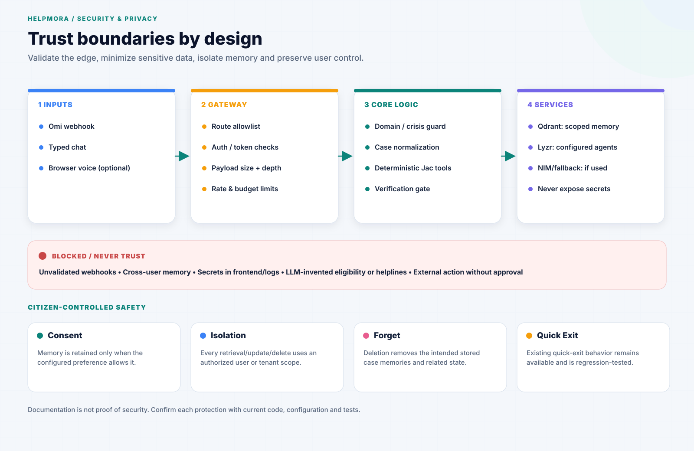
</div>

The project handbook describes the following controls in `helpmora/cmguard/` and related privacy code:

- Route allowlisting and loopback binding of the internal Jac server.
- Request body size/depth limits.
- Token-bucket rate limiting.
- HMAC-SHA256 capability-token support for protected/expensive operations.
- Budget limits and provider-error cooldowns.
- Redaction of PII and secrets from logs/responses.
- Deterministic crisis routing.
- Quick Exit behavior.
- User-scoped Qdrant retrieval and deletion support.

These are architecture/documentation claims; confirm each control with current code and tests before describing it as an independently verified security guarantee.

### Privacy practices

1. Keep `.env` and real credentials out of Git, screenshots, logs and client bundles.
2. Store only data needed to continue the workflow, with a clear retention/consent rule.
3. Avoid persisting raw audio by default.
4. Scope every vector search, update and delete to the authenticated user/tenant and case where appropriate.
5. Ensure that User A cannot retrieve User B's memory.
6. Provide a clear forget/delete path and verify that it removes all intended storage copies.
7. Do not describe sessions as anonymous or private-by-default unless storage, network calls, identity handling and retention behavior genuinely support that description.
8. Require explicit user approval before external or irreversible operations.

## 12. Repository structure

The following tree is based on the project's documented inventory. Keep it aligned to the actual repository as files change.

```text
HELPmora/
├── .github/                         # Repository workflows/configuration
├── .jac/                            # Jac/tooling state where applicable
├── assets/                          # Scalable vector architecture & workflow diagrams (SVG)
├── png/                             # High-resolution raster diagram exports
├── docs/
│   ├── architecture.md              # Architecture reference & trust boundaries
│   ├── demo.md                      # Demo verification guide
│   ├── DEMO_SCRIPT.md               # Paced 5-minute presentation script
│   ├── DEPLOY.md                    # Deployment guidance
│   ├── HACKATHON_CHECKLIST.md       # Submission & verification checklist
│   ├── SECURITY_CHECKLIST.md        # Pre-release security & privacy verification
│   └── MAINTENANCE.md               # Policy/data maintenance
├── helpmora/
│   ├── app.jac                      # Jac application entrypoint
│   ├── app.sv.jac                   # Server-side walker registration
│   ├── frontend.cl.jac              # Client UI root
│   ├── frontend.impl.jac            # Frontend state/navigation
│   ├── cmguard/                     # Gateway, tokens, rate/budget controls, redaction
│   ├── components/                  # Chat, adaptive workflow, plans, graph, telemetry, landing
│   ├── data/
│   │   ├── resources.json           # Curated 40-program catalog
│   │   ├── transitions.json         # Curated 26-bridge paths
│   │   └── i18n/                    # Localization dictionaries
│   ├── engine/                      # Parse, policy, score, plan, paths, privacy, stats
│   ├── graph/                       # Node/edge schema and seed data
│   ├── integrations/
│   │   ├── api.py                   # Documented integration/API routes
│   │   ├── config.py                # Integration configuration/health
│   │   ├── omi/                     # Omi adapter
│   │   ├── qdrant/                  # Vector memory client and schemas
│   │   └── lyzr/                    # Lyzr client and agent coordination
│   ├── orchestration/               # Workflow and CaseState
│   ├── verification/                # Pre-action verification
│   └── walkers/                     # Intake, eligibility, Pathfinder, navigation, safety, memory, etc.
├── ASSET_GUIDE.md                   # Diagram asset placement and raster export guide
├── .env.example                     # Safe placeholders only
├── .gitignore                       # Must exclude .env and generated secrets
├── requirements.txt                 # Python dependencies
├── Dockerfile                       # Container build
├── render.yaml                      # Deployment configuration
├── run.ps1                          # Windows PowerShell startup
├── run.bat                          # Windows Command Prompt startup
├── README.md                        # This file
└── SECURITY.md / PRIVACY.md         # Security and privacy notes
```

### Key files at a glance

| File/path | Role |
|---|---|
| `helpmora/app.jac` | Application entrypoint and UI assembly. |
| `helpmora/app.sv.jac` | Server-side variant loader / walker registration. |
| `helpmora/engine/score.jac` | Deterministic scoring implementation. |
| `helpmora/engine/policy.jac` | Configured policy rules. |
| `helpmora/engine/parse.jac` | Input fact extraction. |
| `helpmora/engine/paths.jac` | Graph traversal support. |
| `helpmora/engine/plan.jac` | Action-plan synthesis. |
| `helpmora/graph/nodes.jac` / `edges.jac` | Graph schema. |
| `helpmora/data/resources.json` | Program catalog. |
| `helpmora/data/transitions.json` | Alternative route catalog. |
| `helpmora/integrations/api.py` | Documented REST/webhook API layer. |
| `helpmora/integrations/omi/adapter.py` | Omi event normalization/deduplication. |
| `helpmora/integrations/qdrant/memory.py` | Qdrant collection/retrieval/privacy operations. |
| `helpmora/integrations/lyzr/agents.py` | Agent role setup. |
| `helpmora/orchestration/case_state.py` | Structured case state and trace. |
| `helpmora/verification/verifier.py` | Verification gate. |
| `helpmora/cmguard/gateway.py` | Defensive gateway. |

## 13. API and integration routes

The project handbook documents the route inventory below. Before relying on an endpoint, confirm that it is present, registered through the actual server/gateway path, and protected as specified in current code.

| Method | Route | Purpose | Scope/auth concept documented |
|---|---|---|---|
| `GET` | `/api/integrations/health` | Integration and core health diagnostics | Public status only; no secrets |
| `POST` | `/api/omi/events` | Real-time Omi transcript event ingestion | `OMI_WEBHOOK_SECRET` / configured webhook protection |
| `POST` | `/omi/conversation` | Completed conversation webhook | Configured webhook protection |
| `POST` | `/omi/realtime` | Chunked/realtime transcript webhook | Configured webhook protection |
| `POST` | `/ask` | Memory-grounded question answering | User scope required |
| `POST` | `/api/helpmora/run` | Run the integrated pipeline from text/voice | User/case scope required |
| `GET` | `/api/helpmora/run/{run_id}` | Retrieve run trace/status | Run/user scope required |
| `POST` | `/api/memory/store` | Store a vector memory | User scope required |
| `POST` | `/api/memory/retrieve` | Semantic memory retrieval | Strict tenant filter required |
| `DELETE` | `/api/memory/{memory_id}` | Delete an individual memory | User/case ownership required |
| `DELETE` | `/api/memory/user/{user_id}` | Delete a user's memories | Authenticated ownership/admin policy required |
| `POST` | `/api/memory/wipe` | Memory deletion alternative | User scope required |
| `POST` | `/api/privacy/update` | Update retention/privacy settings | User scope required |
| `POST` | `/api/workflow/approve` | Human approval gate | Run and user scope required |
| `POST` | `/api/workflow/voice-to-form` | Parse speech into a form field | Validate fields and case scope |
| `GET` | `/api/workflow/explain-field` | Explain a statutory/form field | Validate requested field and source context |
| `GET` | `/api/workflow/recovery` | Suggest recovery options for missing prerequisites | Ground guidance in configured data |

**Security note:** a route listed in documentation is not proof that it is publicly reachable or safe to expose. `cmguard` and the actual server route registration determine the public surface. Do not expose deletion, approval, or user-scoped memory routes without validating ownership and authorization.

## 14. Local development

<div align="center">
  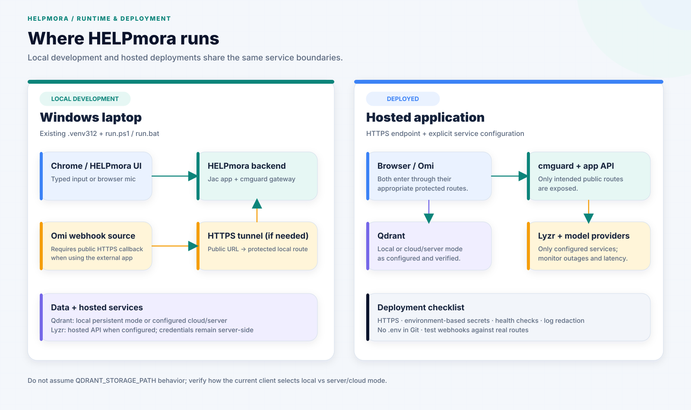
</div>

The project repository includes Windows startup scripts and a Python 3.12 virtual environment is documented in the project materials. Use the existing environment rather than creating another one.

### Windows PowerShell

From the repository root:

```powershell
# Optional if the existing environment is not already active
.\.venv312\Scripts\Activate.ps1

# Install the project's pinned dependencies if required
python -m pip install -r requirements.txt

# Start using the project's existing script
.\run.ps1
```

### Windows Command Prompt

```bat
run.bat
```

Open the local URL printed by the startup script. The project handbook references `http://localhost:8000/`; use the actual port configured by the active script if it differs.

### Core-only mode and full integration mode

- **Core-only mode:** existing local chat and deterministic functionality work without optional Omi/Qdrant Cloud/Lyzr services, to the extent supported by the current code and existing provider configuration.
- **Full integration mode:** requires real credentials/configuration, reachable services, configured Omi webhooks, and the relevant backend routes. Validate each integration with a health/smoke test.

Do not treat a non-empty environment variable as proof that a service is connected.

## 15. Environment configuration

The repository already has a root `.env.example`. Extend that file only when necessary. Put real values in a root `.env`, keep `.env` untracked, and never put secrets in frontend code.

| Variable | Intended purpose | Required when |
|---|---|---|
| `NVIDIA_NIM_API_KEY` | Existing NIM model chain | The current model configuration uses NVIDIA NIM. |
| `FEATHERLESS_API_KEY` | Optional existing fallback | Featherless fallback is enabled. |
| `GROQ_API_KEY` | Optional existing model option | Groq model pool is enabled. |
| `HELPMORA_POLICY_DATE` | Pin policy evaluation date where supported | When intentionally setting an effective date. |
| `HELPMORA_LLM_MODELS` | Override the configured model fallback chain | When overriding defaults. |
| `HELPMORA_POLYGLOT_MODELS` | Configure language-related summary models | When overriding defaults. |
| `OMI_API_KEY` | Authenticate supported outbound Omi API calls | Only when the chosen Omi API operation requires it. |
| `OMI_WEBHOOK_SECRET` | Secret/token used by the implemented webhook protection | When configured webhook validation uses it. |
| `PUBLIC_BASE_URL` | Public HTTPS callback base URL | When Omi needs to call a local/deployed backend. |
| `QDRANT_URL` | Qdrant server/cloud URL | When using server/cloud mode. |
| `QDRANT_API_KEY` | Qdrant Cloud authentication | When the configured Qdrant endpoint requires it. |
| `QDRANT_COLLECTION_NAME` | Memory collection name; documented default `helpmora_memory` | Used by the Qdrant integration. |
| `QDRANT_STORAGE_PATH` | Local on-disk path where supported | When the current client uses local persistence. |
| `LYZR_API_KEY` | Authenticate hosted Lyzr calls | When Lyzr orchestration is enabled. |
| `LYZR_ENVIRONMENT_ID` | Lyzr environment/config identifier | If required by current client code. |
| `LYZR_MANAGER_AGENT_ID` | Configured Lyzr Manager agent identifier | When invoking that Manager. |

### Safe example

```env
# Existing model configuration — fill only what you actually use
NVIDIA_NIM_API_KEY=
FEATHERLESS_API_KEY=
GROQ_API_KEY=
HELPMORA_POLICY_DATE=
HELPMORA_LLM_MODELS=
HELPMORA_POLYGLOT_MODELS=

# Omi — variables needed depend on the selected official capability
OMI_API_KEY=
OMI_WEBHOOK_SECRET=
PUBLIC_BASE_URL=

# Qdrant
QDRANT_URL=
QDRANT_API_KEY=
QDRANT_COLLECTION_NAME=helpmora_memory
QDRANT_STORAGE_PATH=./data/qdrant_db

# Lyzr
LYZR_API_KEY=
LYZR_ENVIRONMENT_ID=
LYZR_MANAGER_AGENT_ID=
```

This block contains placeholders only. Do not copy real secrets into this README or `.env.example`.

### Local Omi webhook testing

An external Omi service cannot normally call a private `localhost` URL directly. For local webhook tests, expose only the required protected route through a temporary public HTTPS tunnel, or use a deployed HTTPS environment. Configure the full webhook path in Omi according to the route that exists in the running code. Return an acknowledgement quickly after safely accepting a valid event; perform slow processing asynchronously.

Use synthetic test data for webhook inspection. Do not send real citizen information or secrets to public payload-inspection services.

## 16. Testing and observability

Run the existing test suite using the repository's documented test command. The exact command must be confirmed from the current project configuration; do not assume a file called `test_integrations.py` is present without checking the repository.

### Recommended verification matrix

| Area | Test | Evidence to capture |
|---|---|---|
| Existing app | Start, open UI, send typed request | UI response and server logs without secrets |
| Jac policy engine | Evaluate known synthetic profiles | Deterministic structured result and explanations |
| Pathfinder | Test direct fit and blocked-route examples | Selected curated edge sequence or empty result |
| Crisis | Synthetic crisis keyword case | Deterministic escalation path; no LLM dependency on critical path |
| Omi | Send a real Omi transcript event | Webhook receipt, validated normalized event, trace/run ID |
| Qdrant | Store then retrieve in a fresh request/runtime context | Stored point + retrieval result with user filter |
| Tenant isolation | Query as a second synthetic user | No cross-user memory returned |
| Lyzr | Execute the configured Manager/agent | Real provider response/trace; do not rely solely on mocks |
| Approval | Exercise approve and reject paths | No action before approval; rejection returns safely |
| Forget | Delete synthetic user's memory | Subsequent retrieval returns no deleted memory |
| Failure recovery | Disable one optional service | Clear status; core functions behave according to supported fallback |
| Accessibility | Keyboard, large text, contrast, reduced motion | Manual notes/screenshots and relevant automated tests |

### Health and trace

The documented health endpoint is `/api/integrations/health`. When available, it should report component states such as `CONNECTED`, `NOT_CONFIGURED`, `UNAVAILABLE` or `INVALID_CONFIGURATION` without exposing secrets. Execution traces should contain timestamps, stage, status, duration and a correlation/run ID—but not raw sensitive transcripts or credential values.

Avoid hard-coding performance values into the landing page unless measured on the target environment and representative workloads. Distinguish deterministic engine latency from total user-perceived latency, which includes network, retrieval, orchestration and speech processing.

## 17. Demo scenario

<div align="center">
  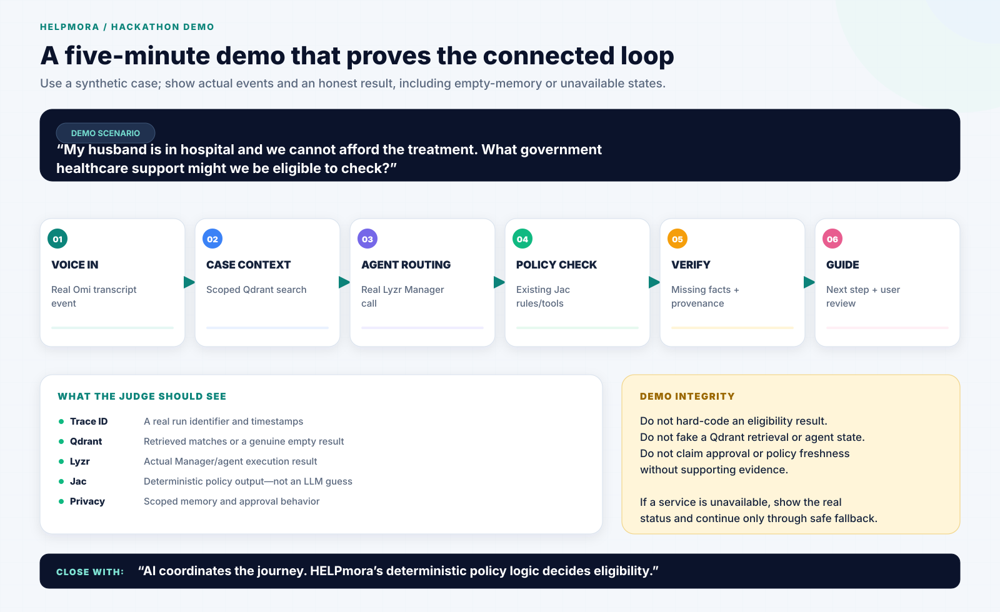
</div>

Use a synthetic, India-focused case that is realistic but does not presuppose eligibility:

> “My husband is in hospital and we cannot afford the treatment. I want to know what government healthcare support we may be eligible for.”

A successful demonstration should show the system identify the healthcare need, request missing facts where relevant, evaluate configured resources with the Jac engine, explain uncertainty, and produce a practical next step. Do not claim a specific person qualifies based only on the example sentence.

### Five-minute demo outline

| Time | Show | What to say |
|---|---|---|
| 0:00–0:30 | The problem and landing page | Welfare and legal-aid information is fragmented and hard to navigate. |
| 0:30–1:15 | Real voice input | A real Omi event enters HELPmora; show the transcript arriving. |
| 1:15–2:00 | Qdrant retrieval | Show scoped prior memory or a genuine empty result. |
| 2:00–2:45 | Lyzr orchestration | Show a real Manager/agent call and structured output. |
| 2:45–3:40 | Jac decision and Pathfinder | Show deterministic evaluation and any actual configured alternative path. |
| 3:40–4:25 | Guided workflow | Show required information/documents and approval behavior. |
| 4:25–5:00 | Session resume and trust boundary | Start a fresh request, retrieve prior case if enabled, and state that Jac—not the LLM—decides eligibility. |

If an integration cannot be run live, do not stage a fake status. Explain the limitation and demonstrate the verified portions honestly.

## 18. Hackathon fit and submission checklist

### Recommended primary track

**Accessibility & Adaptive Assistants** — the project turns high-friction welfare tasks into conversational intake, structured forms, explanations and guided workflows.

Supporting strengths include collaborative multi-agent workflows and privacy-first case memory. Choose one primary track and use the same label in the submission form and README.

The supplied submission guide states that working software, a clean repository and observable agent workflows contribute **60% or more** of the final score. Prioritize a real, demonstrable end-to-end loop over additional decorative UI. The same guide lists **13 October 2026, 11:59 PM IST** as the deadline; verify the live platform for any later update.

### Mandatory stack evidence

- [ ] **Omi:** Real transcript/voice event reaches HELPmora.
- [ ] **Qdrant:** Real vector write and subsequent semantic retrieval work.
- [ ] **Lyzr:** A real configured agent/Manager execution is shown.
- [ ] **Connected loop:** One request flows through voice, memory, orchestration and the authoritative Jac core.
- [ ] **Observable workflow:** Actual events/states are visible to a viewer.
- [ ] **Architecture diagram:** Included in this README and aligned with the implementation.
- [ ] **Public repository:** README, setup instructions, dependencies and safe configuration are included.
- [ ] **Secrets:** No real API keys or `.env` committed.
- [ ] **Build track:** Named consistently.
- [ ] **Deployed demo:** Link works for another person or required deployment limitations are documented.
- [ ] **Demo video:** Five minutes maximum, including problem, live workflow and Omi/Qdrant/Lyzr roles.
- [ ] **Submission form:** Project title, description, repository, demo URL/video and technology usage are complete.

The hackathon guide specifies a public repository, a working demo, an architecture diagram, all three integrations, no committed secrets and a video of no more than five minutes. Confirm the active hackathon platform for the final submission form and deadline details.

## 19. Known limitations and release checks

Before calling a build production-ready, verify the following against source code, current data and live services:

- Official program URLs, statutory conditions, state/jurisdiction differences and effective dates are up to date.
- The `hud_income_limits.json` file named in the repository inventory is traced and does not accidentally apply U.S.-specific rules to India-only flows.
- The UI no longer displays legacy U.S.-specific concepts, currency, examples or “federal/HUD/HRSA” policy claims for India-focused journeys unless clearly isolated to a test fixture.
- The 51 localization dictionaries are not described as fully human-validated language support without end-to-end tests and review.
- Omi event payloads are captured from the actual capability and parsed from the real schema.
- Webhook authentication matches the actual Omi integration model; a local secret variable alone does not protect an endpoint unless the code validates it.
- Qdrant persistence and tenant isolation pass real-service tests.
- Lyzr orchestration is verified with the actual configured agent ID and API key.
- Case deletion removes all intended data across graph, Qdrant and other persistence layers.
- Metrics such as latency and number of model calls are measured rather than assumed.

## 20. Maintenance and contribution

Policy catalogs are living data. A safe update process should record at least:

- Official source name and URL.
- Jurisdiction and program scope.
- Effective date or applicable period, if available.
- Last-verified date.
- Version/change note.
- Tests for affected eligibility rules and transition routes.

Keep code changes focused. Add regression tests for changed rules or routes, preserve the deterministic/LLM boundary, and update documentation and demo claims whenever the implementation changes.

For a code contribution:

1. Inspect the existing architecture and tests.
2. Make the smallest necessary change.
3. Add or update focused tests.
4. Run regression tests.
5. Check secrets, logging and user-isolation boundaries.
6. Update the matching documentation/diagram if system behavior changed.

## 21. Documentation files bundled with this README

The ZIP package also includes the following focused companion documents:

- [`docs/architecture.md`](docs/architecture.md) — trust boundaries and failure behavior.
- [`docs/SECURITY_CHECKLIST.md`](docs/SECURITY_CHECKLIST.md) — pre-release security and privacy verification.
- [`docs/DEMO_SCRIPT.md`](docs/DEMO_SCRIPT.md) — a paced five-minute demo script.
- [`docs/HACKATHON_CHECKLIST.md`](docs/HACKATHON_CHECKLIST.md) — project, integration and submission checklist.

## 22. Official and project resources

- **Omi developer documentation:** <https://docs.omi.me/>
- **Omi open-source repository:** <https://github.com/BasedHardware/omi>
- **Qdrant documentation:** <https://qdrant.tech/documentation/>
- **Lyzr documentation:** <https://docs.lyzr.ai/>
- **Jac documentation:** <https://docs.jaseci.org/>
- **Hackathon submission page:** <https://app.hidevs.xyz/hackathons/stop-prompting-solo-agents-hackathon-2026?tab=submit>

Use current official documentation for provider APIs, webhook payloads, authentication and supported features. Do not treat example endpoints or variable names in a static README as a substitute for verifying the actual implementation.

---

<div align="center">
  **HELPmora — Your story. Your next step.**

  *AI coordinates the journey. Deterministic policy logic remains accountable for eligibility.*
</div>
