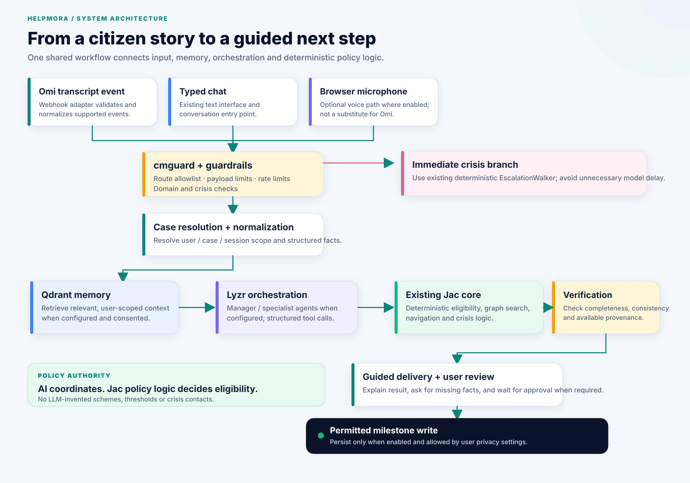

# HELPmora Architecture Notes

This document expands the architecture section of the root README. Use the current source code as the authority when repository implementation and documentation differ.

## Design goals

1. Make a citizen's unstructured story usable as structured case state.
2. Preserve a deterministic policy authority for eligibility and graph decisions.
3. Use Qdrant to retrieve relevant, consented case memory without making memory the policy authority.
4. Use Lyzr to coordinate specialist tasks, not to invent or overrule statutory rules.
5. Keep Omi, browser voice, and typed chat on one conversation-processing path.
6. Keep crisis routing fast and deterministic.
7. Make the workflow observable and require confirmation before consequential side effects.

## Main boundaries

```mermaid
flowchart LR
    INPUT[Omi / browser / typed input] --> ADAPTER[Input adapters]
    ADAPTER --> API[Validated shared service]
    API --> GUARD[cmguard + domain/crisis checks]
    GUARD --> CONTEXT[CaseState + Qdrant retrieval]
    CONTEXT --> ORCH[Lyzr orchestration]
    ORCH --> TOOLS[Typed HELPmora tools]
    TOOLS --> JAC[Jac policy and graph core]
    JAC --> VERIFY[Verification / provenance]
    VERIFY --> DELIVERY[Guided response]
    DELIVERY --> APPROVAL[Human approval gate]
    APPROVAL --> MEMORY[Allowed case milestone to Qdrant]
```

## Authority model

| Question | Authority |
|---|---|
| What did the user say? | The validated transcript/input source and user confirmation |
| What happened in a previous case? | Qdrant result scoped to the authenticated user/case, subject to retention settings |
| Which task should be run? | Lyzr orchestration constrained by supported tools and workflow rules |
| Does the configured policy match the case? | Existing deterministic Jac policy engine and current configured policy data |
| Is this an immediate crisis? | Existing domain/crisis guardrails and deterministic EscalationWalker |
| Can an external action proceed? | Explicit user approval and the implemented action gate |

## Data graph vs vector memory

The Jac graph expresses structured relationships: person, need, program, rule, form, application and transition. Qdrant supports semantic retrieval over approved episodic memory. They solve different problems and should not be used as interchangeable stores.

## Asynchronous webhook boundary

Omi webhook handlers should validate and safely accept events, then acknowledge quickly. Long-running Qdrant and Lyzr work should happen after acceptance using the existing background/durable-work mechanism. Event IDs and session identifiers must prevent duplicate or cross-session execution.

## Failure behavior

- Omi missing: retain typed input and any separately supported browser voice mode.
- Qdrant unavailable: do not invent prior context; expose memory-unavailable state and use only approved fallback behavior.
- Lyzr unavailable: do not display a fake agent execution; fall back only to an existing supported path.
- Jac policy failure: do not manufacture an eligibility answer.
- Verification failure: pause or downgrade the result to needs-review.
- Approval not given: do not perform the consequential side effect.

## Real integration evidence

Keep a verification record for each deployed integration with date, non-sensitive test identifier, result, and known limitations. Never store API keys or raw sensitive transcripts in the verification record.
